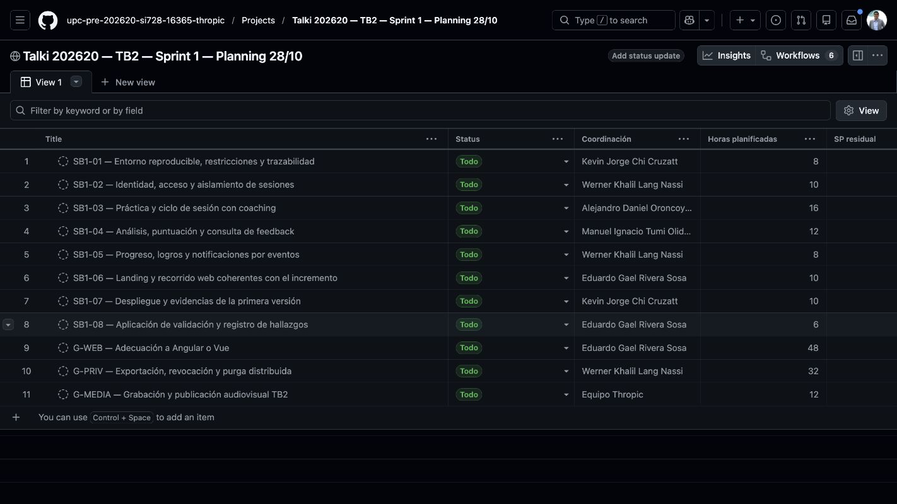
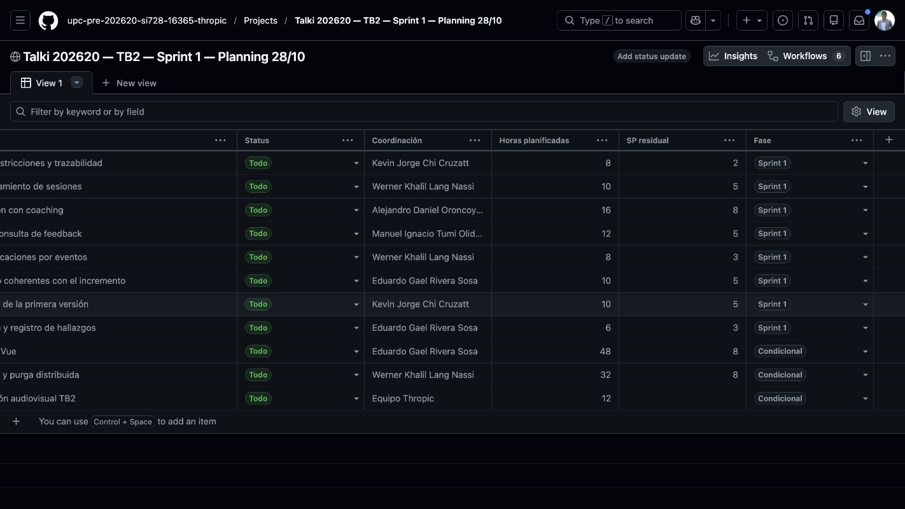

# Definición de Sprint 1 para TB2

#### 7.2.1.1. Sprint Planning 1

La reunión de planning se realizó el **28 de octubre de 2026, de 20:00 a 21:00 (America/Lima), por Google Meet**, con asistencia de los cinco integrantes, según la confirmación del Team Leader. La siguiente definición operativa se completó documentalmente el 30/10/2026 sobre los servicios y evidencias disponibles. La fecha, el horario, la modalidad y los asistentes están confirmados. Las estimaciones de capacidad y las asignaciones operativas se identifican como propuesta del plan; no se atribuyen acuerdos no informados a la reunión del día 28.

**Sprint Goal.** Demostrar un recorrido integrado de acceso, preparación, práctica, cierre y consulta de feedback, aprovechando los ocho servicios existentes. Cada comportamiento presentado debe enlazar historia, tarea, commit, prueba y evidencia de ejecución. La meta es una primera versión demostrable; el cumplimiento completo de una User Story requiere todos sus criterios originales de 3.3.

| Campo | Definición y estado |
| --- | --- |
| Entrega / iteración | TB2 / Sprint 1 del periodo 202620. |
| Fecha de reunión | 28/10/2026, confirmada por el Team Leader. |
| Modalidad y plataforma | Remota por Google Meet, confirmada por el Team Leader. |
| Hora de inicio y fin | 20:00–21:00, hora de Lima (UTC−05:00), confirmadas por el Team Leader. |
| Duración | 60 minutos. |
| Preparación e integración del plan | Alejandro Daniel Oroncoy Almeyda, para revisión del equipo. |
| Integrantes asistentes | Alejandro Daniel Oroncoy Almeyda; Eduardo Gael Rivera Sosa; Manuel Ignacio Tumi Oliden; Werner Khalil Lang Nassi; Kevin Jorge Chi Cruzatt. |
| Asistencia efectiva a la reunión | Cinco de cinco integrantes presentes, confirmado por el Team Leader. |
| Ventana operativa propuesta | 31/10–08/11/2026, para el trabajo residual definido al 30/10; fechas sujetas a ratificación. No se atribuye este calendario a un acuerdo ya confirmado del 28/10. |
| Fecha institucional de entrega | El enunciado sitúa TB2 en semana 12; confirmar fecha/hora publicada en Blackboard. El 08/11 es un cierre interno propuesto. |
| Insumos | Capítulos I–VI; backlog de 3.5; ocho servicios reutilizados y cliente; 133 pruebas unitarias aprobadas; contratos y prueba HTTP local del 30/10. |
| Revisión previa | Feedback del parcial: 19/20, con diseño táctico/UX 10/10 y documentación/colaboración 9/10. |
| Mejora incorporada al plan | Aportes individuales verificables; documentación trazable; lámina del equipo y demostración de artefactos en herramientas. Son insumos del feedback; no se registra una retrospectiva adicional inexistente. |
| Estimación | 8 PBIs con 24 tareas: **36 SP residuales y 80 h de trabajo**. Las cifras son pronóstico inicial, no velocidad ni tiempo ejecutado. |
| Capacidad propuesta | 5 integrantes × 20 h = **100 h**: 80 h de tareas, 10 h de coordinación/revisión y 10 h de contingencia. Disponibilidad individual pendiente de confirmación. |
| Compromiso propuesto | Completar SB1-01–SB1-08 conforme a sus criterios, condicionado a capacidad ratificada, accesos/recursos disponibles y resolución de bloqueos. Si cambian esos insumos, se replanifica antes de afirmar un compromiso del equipo. |

**Base disponible y alcance pendiente.** La importación de código, los 133 resultados unitarios, los ocho documentos OpenAPI y los casos HTTP del 30/10 son insumos ya disponibles. No se estiman otra vez como si fueran desarrollo nuevo. El trabajo residual consiste en resolver diferencias, integrar, ejecutar aceptación, recuperar despliegue y documentar resultados. Las ampliaciones del producto se mantienen en la hoja de ruta completa, sin prometer su ejecución dentro de estas mismas 80 horas.

| Servicio o producto existente | Responsabilidad en la base | PBI que verifica o completa su integración |
| --- | --- | --- |
| identity-service | Registro, autenticación y segmento. | SB1-02; seguridad de acceso y BFF en SB1-06. |
| session-service | Sesiones, estados, consulta y feedback asociado. | SB1-02, SB1-03 y SB1-04. |
| live-coach-service | Modos, credencial efímera y evento de cierre de voz. | SB1-03. |
| filler-detection-service | Detección de muletillas desde el evento de cierre. | SB1-04. |
| scoring-service | Cálculo y publicación de puntuación. | SB1-04; proyecciones posteriores en SB1-05. |
| progress-service | Resumen del progreso a partir de evaluaciones. | SB1-05. |
| gamification-service | Rachas y logros según sesiones válidas. | SB1-05. |
| notification-service | Consumo de eventos de evaluación/logro y aviso disponible. | SB1-05. No se presume un canal de correo configurado. |
| Cliente web, landing y BFF | Pantallas, sesión del navegador y consumo de APIs. | SB1-02, SB1-03 y SB1-06; G-WEB si se requiere adecuación. |
| RabbitMQ, persistencia y ambiente | Integración entre servicios y ejecución reproducible/desplegada. | SB1-01 y SB1-07. |

**Reparto de capacidad propuesto.** Un coordinador por PBI organiza el cierre; las tareas de 7.2.1.2 indican quién hace cada parte. Las horas de apoyo se contabilizan a su responsable, no se suman de nuevo al coordinador.

| Integrante | Tareas asignadas en el plan | Trabajo | Coordinación / revisión | Reserva | Total propuesto |
| --- | --- | ---: | ---: | ---: | ---: |
| Alejandro Daniel Oroncoy Almeyda | SB1-01-A, SB1-03-A, SB1-03-B, SB1-03-C, SB1-07-C | 16 h | 2 h | 2 h | 20 h |
| Eduardo Gael Rivera Sosa | SB1-01-B, SB1-06-A, SB1-06-B, SB1-06-C, SB1-08-A | 16 h | 2 h | 2 h | 20 h |
| Manuel Ignacio Tumi Oliden | SB1-04-A, SB1-04-B, SB1-04-C, SB1-05-A | 16 h | 2 h | 2 h | 20 h |
| Werner Khalil Lang Nassi | SB1-02-A, SB1-02-B, SB1-05-B, SB1-07-D, SB1-08-B | 16 h | 2 h | 2 h | 20 h |
| Kevin Jorge Chi Cruzatt | SB1-01-C, SB1-02-C, SB1-03-D, SB1-07-A, SB1-07-B | 16 h | 2 h | 2 h | 20 h |
| **Total** | **24 tareas** | **80 h** | **10 h** | **10 h** | **100 h** |

Los SP de cada PBI usan la escala 1, 2, 3, 5 y 8 para estimar el **trabajo que queda** sobre la base reutilizada. Los SP originales de las User Stories y Technical Stories de 3.5 se conservan; no se suman a estos 36 puntos ni se convierten mediante una regla de horas por punto. La velocidad del equipo se medirá al cerrar trabajo realmente aceptado.

**Secuencia propuesta y dependencias.** La secuencia organiza cierres, permitiendo iniciar antes las tareas cuyos insumos ya estén disponibles. Por ejemplo, el ambiente de SB1-07-A puede prepararse con SB1-01-C, aunque el despliegue integrado de SB1-07-B espere al cliente y al análisis.

| Ventana propuesta | Trabajo prioritario | Salida comprobable |
| --- | --- | --- |
| 31/10–01/11 | SB1-01; registro/acceso de SB1-02; landing de SB1-06-A. | Entorno reproducible, decisión tecnológica registrada y acceso con fixtures. |
| 02/11–04/11 | Autorización, estados de sesión, token/voz, cierre y preparación de ambiente. | Sesión autorizada y correlación del evento; errores de estado controlados. |
| 04/11–06/11 | Análisis/feedback, cliente integrado, progreso, logros y aceptación. | Reporte trazable y pruebas del recorrido; integración por eventos comprobada. |
| 07/11–08/11 | Despliegue, validación con ambos segmentos, matriz de evidencias, review y retrospectiva. | URLs y capturas actuales; registros reales de validación; balance de terminado/pendiente. |

La coordinación propuesta comprende seis sincronizaciones de diez minutos y una sesión de review/retrospectiva de sesenta minutos por integrante: dos horas en total. Las diez horas de reserva del equipo absorben incidencias pequeñas; no cubren una migración completa de tecnología o una ampliación de alcance de decenas de horas.

**Definition of Ready.** Antes de iniciar una tarea deben existir su criterio de aceptación, responsable, dependencia resuelta, repositorio/commit de base e insumos de prueba. Si requiere credenciales, presupuesto cloud, acceso al proveedor o participantes, se registra el bloqueo concreto. Nunca se incluye un secreto en el tablero o en la captura.

**Definition of Done del incremento.** Cada PBI se acepta cuando: (1) el cambio está integrado y revisado mediante commit/PR; (2) sus pruebas unitarias pertinentes y la integración/aceptación correspondiente pasan; (3) contrato, estado de error y propiedad del recurso están comprobados; (4) la demostración usa datos identificados y muestra el alcance real; (5) el informe enlaza la evidencia del commit probado; y (6) el objetivo de despliegue usa el ambiente efectivo. Una historia completa solo se marca terminada si cumple todos los criterios de 3.3. Una captura de prototipo o de la base histórica no acredita esas condiciones.

**Criterios de aceptación de la review.** Se debe demostrar acceso, preparación, práctica corta, cierre y consulta del resultado con los dos perfiles académicos; repetir una finalización no debe duplicar la evaluación; una sesión inválida no debe inventar puntuación; un usuario no debe acceder a la sesión ajena. Los ocho servicios deben poder documentarse mediante OpenAPI en el ambiente mostrado, y las 133 pruebas base deben seguir aprobadas después de los cambios pertinentes. Se incorpora al menos un escenario BDD ejecutado con sus steps y un caso de error. El resultado observado de las tareas de validación se informa con su muestra real, sin prometer de antemano alcanzar QAS-USA-01.

**Decisiones operativas propuestas.** Limitar a una tarea de implementación en curso por integrante y dos revisiones simultáneas; actualizar diariamente el estado con evidencia; conservar la procedencia 202601; revisar autorización, consentimiento y privacidad antes de datos personales reales; y mantener los videos diferidos identificados como pendientes. Estas decisiones están definidas para ratificación, no se presentan como acta literal de acuerdos no aportados por el equipo.

#### 7.2.1.2. Sprint Backlog 1

El backlog sustituye las diez tareas genéricas iniciales por **ocho PBIs y 24 tareas**, todos definidos con responsable propuesto, horas, dependencia y aceptación. El estado inicial es **Por hacer** para el trabajo residual; los activos existentes del 30/10 se conservan como base disponible y no convierten las historias completas en trabajo terminado.

| PBI | Incremento | Historias / contratos relacionados | Coordinación propuesta | SP residuales | Trabajo | Dependencias para el cierre |
| --- | --- | --- | --- | ---: | ---: | --- |
| SB1-01 | Entorno reproducible, restricciones y trazabilidad | Transversal | Kevin | 2 | 8 h | Ninguna |
| SB1-02 | Identidad, acceso y aislamiento de sesiones | US05, US06, US20, US23, US28, US33 | Werner | 5 | 10 h | SB1-01 |
| SB1-03 | Práctica y ciclo de sesión con coaching | US09, US10, US12, US13, US14, US29, US34, US38, TS01, TS02 | Alejandro | 8 | 16 h | SB1-01, SB1-02 |
| SB1-04 | Análisis, puntuación y consulta de feedback | US15, US16, US20, US26, US37, TS03, TS04 | Manuel | 5 | 12 h | SB1-03 |
| SB1-05 | Progreso, logros y notificaciones por eventos | US21, US35, TS05 | Werner | 3 | 8 h | SB1-04 |
| SB1-06 | Landing y recorrido web coherentes con el incremento | US01, US02, US03, US04, US09, US15, US20, US29 | Eduardo | 5 | 10 h | SB1-01, SB1-02 |
| SB1-07 | Despliegue y evidencias de la primera versión | TS01, TS02, TS03, TS04 | Kevin | 5 | 10 h | SB1-01, SB1-02, SB1-03, SB1-04, SB1-05, SB1-06 |
| SB1-08 | Aplicación de validación y registro de hallazgos | US01, US09, US15, US20, US29, US33 | Eduardo | 3 | 6 h | SB1-06 |
| **Total** | **8 PBIs / 24 tareas** | **Cobertura mínima y trazable; criterios completos en 3.3** | **Equipo** | **36** | **80 h** | **Ver dependencias de tarea** |

**Base comprobada y trabajo restante.** Los estados siguientes describen el insumo real de cada PBI al 30/10. El estado `Todo` del tablero corresponde únicamente a las tareas residuales definidas; no significa que los servicios deban construirse desde cero.

| PBI / estado de base | Evidencia disponible | Trabajo residual estimado |
| --- | --- | --- |
| SB1-01 — Disponible | Ocho servicios compilados, 133 unitarias aprobadas y ocho OpenAPI locales capturados. | Cerrar runbook de clon limpio, decisión tecnológica y concordancia de contratos/despliegue. |
| SB1-02 — Parcial | Registro 201, login 200 y consulta/listado de una sesión fixture comprobados. | Verificar/logout, errores, expiración y autorización cruzada entre dos cuentas. |
| SB1-03 — Integración pendiente | Crear sesión 201, modos 200; finalizar DRAFT dio 500 y token sin clave dio 503 esperado. | Cerrar estados/consentimiento, voz configurada, correlación y cierre sin duplicados. |
| SB1-04 — Base disponible | 11 unitarias de detección de muletillas y 33 de scoring aprobadas; contratos de eventos presentes. | Comprobar recorrido asíncrono, consulta de feedback, errores, duplicados y aceptación BDD. |
| SB1-05 — Base disponible | 9 unitarias de progreso, 13 de gamificación y 7 de notificaciones; consultas iniciales de progreso/racha 200. | Demostrar actualización real por evento válido y que el duplicado no repite efectos. |
| SB1-06 — Cliente/prototipo disponibles | Compilación Next.js aprobada; galería y prototipo públicos dieron 200. | Integrar el recorrido real, ajustar landing/errores y resolver conformidad del framework. |
| SB1-07 — Bloqueado por despliegue | En la comprobación del 30/10, frontend histórico 402 y 16 rutas Railway 404. | Acceso a recursos, perfiles/persistencia, publicación y verificación del ambiente efectivo. |
| SB1-08 — Protocolo listo | Guion de validación y registro de seis participantes preparado; sin sesiones o resultados acreditados. | Reclutar/aplicar a ambos segmentos y registrar observaciones y heurísticas reales. |

**SB1-01 — Entorno reproducible, restricciones y trazabilidad.** Servicios: Todos los servicios, Cliente web.

| Tarea | Responsable propuesto | Horas | Dependencias | Criterio de aceptación | Estado |
| --- | --- | ---: | --- | --- | --- |
| **SB1-01-A** Cerrar el runbook de arranque y configuración | Alejandro | 3 | Ninguna | Un clon limpio puede compilar con JDK 17, iniciar un único RabbitMQ y los ocho servicios; el runbook separa H2 local de persistencia pública y no expone secretos. | Por hacer |
| **SB1-01-B** Registrar decisiones de tecnología y alcance | Eduardo | 2 | Ninguna | Matriz de enunciado frente al stack real; decisión Angular/Vue o autorización adjunta. Si sigue abierta, se registra bloqueo de conformidad y no se renombra Next.js. | Por hacer |
| **SB1-01-C** Versionar contrato y evidencia del entorno | Kevin | 3 | SB1-01-A | URLs/puertos, commit base, diagrama de despliegue ejecutable y ocho contratos OpenAPI coherentes; enlaces de las evidencias en el informe. | Por hacer |

**SB1-02 — Identidad, acceso y aislamiento de sesiones.** Servicios: identity-service, session-service, BFF del cliente.

| Tarea | Responsable propuesto | Horas | Dependencias | Criterio de aceptación | Estado |
| --- | --- | ---: | --- | --- | --- |
| **SB1-02-A** Verificar registro, login, segmento y logout | Werner | 4 | SB1-01-A | Registro nuevo 201, login válido 200, credenciales inválidas con respuesta controlada y logout invalida acceso del cliente; usar cuentas fixture y ocultar JWT. | Por hacer |
| **SB1-02-B** Implementar o comprobar autorización por propietario | Werner | 4 | SB1-02-A | Dos cuentas de prueba: el usuario B no puede leer, listar, finalizar o añadir feedback a la sesión de A. La identidad validada prevalece sobre userId enviado por el cliente. | Por hacer |
| **SB1-02-C** Integrar errores de acceso en el cliente | Kevin | 2 | SB1-02-A | Cliente conserva sesión en cookie httpOnly y presenta errores recuperables sin exponer token; prueba de expiración y retorno al login documentada. | Por hacer |

**SB1-03 — Práctica y ciclo de sesión con coaching.** Servicios: session-service, live-coach-service, Cliente web, Gemini Live.

| Tarea | Responsable propuesto | Horas | Dependencias | Criterio de aceptación | Estado |
| --- | --- | ---: | --- | --- | --- |
| **SB1-03-A** Cerrar máquina de estados y consentimiento | Alejandro | 4 | SB1-02-B | Ruta de inicio autorizada y transición DRAFT a RECORDING definidas; finalizar desde estado inválido devuelve error de negocio controlado, no 500. Registrar consentimiento antes de captura. | Por hacer |
| **SB1-03-B** Comprobar integración de voz y token efímero | Alejandro | 4 | SB1-03-A | Credencial permanente solo en servidor; permiso denegado, clave ausente y token vencido se comunican. Con configuración autorizada se prueba un ensayo corto sin publicar audio personal. | Por hacer |
| **SB1-03-C** Unificar finalización y evento de análisis | Alejandro | 4 | SB1-03-A, SB1-03-B | El ID persistido de sesión se conserva en coach y eventos; finalizar una vez produce una sola evaluación lógica. Repetir la petición no duplica resultados. | Por hacer |
| **SB1-03-D** Demostrar controles de práctica y errores | Kevin | 4 | SB1-03-B, SB1-03-C | Web muestra grabación, pausa/reanudación y cierre confirmado; permiso denegado y desconexión tienen recuperación o resultado parcial explícito. No declarar recuperación integral si no se verifica. | Por hacer |

**SB1-04 — Análisis, puntuación y consulta de feedback.** Servicios: filler-detection-service, scoring-service, session-service.

| Tarea | Responsable propuesto | Horas | Dependencias | Criterio de aceptación | Estado |
| --- | --- | ---: | --- | --- | --- |
| **SB1-04-A** Comprobar contratos del pipeline y duplicados | Manuel | 4 | SB1-03-C | Fixture recorre session.live.finalized, fillers.analyzed y scoring.completed con el mismo sessionId/userId; duplicado reconocido y fallo con estado visible. | Por hacer |
| **SB1-04-B** Persistir y consultar feedback mínimo trazable | Manuel | 4 | SB1-04-A | Reporte recuperable de la sesión del propietario contiene puntuación, muletillas, evidencia y límites. Estados pendiente/fallido no muestran una evaluación inventada; diferencias con TS04 versionado registradas. | Por hacer |
| **SB1-04-C** Ejecutar aceptación del recorrido de feedback | Manuel | 4 | SB1-04-B | Pruebas de integración y al menos un feature BDD ejecutable con steps verifican el caso feliz y un error; se adjuntan commit, comando y resultado. No convertir el conteo unitario en aceptación. | Por hacer |

**SB1-05 — Progreso, logros y notificaciones por eventos.** Servicios: progress-service, gamification-service, notification-service.

| Tarea | Responsable propuesto | Horas | Dependencias | Criterio de aceptación | Estado |
| --- | --- | ---: | --- | --- | --- |
| **SB1-05-A** Verificar proyección de progreso | Manuel | 4 | SB1-04-A | Scoring válido actualiza una sola vez el resumen del propietario; comparar el antes/después con el mismo fixture y conservar métricas/versiones disponibles sin inferir comparación avanzada. | Por hacer |
| **SB1-05-B** Verificar racha y aviso sin duplicados | Werner | 4 | SB1-05-A | Sesión válida activa la regla de racha/logro y el consumidor de notificaciones; reenvío del evento no duplica el efecto. Mostrar qué canal de aviso existe realmente; no afirmar envío de email no configurado. | Por hacer |

**SB1-06 — Landing y recorrido web coherentes con el incremento.** Servicios: Landing, Cliente web, BFF.

| Tarea | Responsable propuesto | Horas | Dependencias | Criterio de aceptación | Estado |
| --- | --- | ---: | --- | --- | --- |
| **SB1-06-A** Actualizar landing y estados vacíos | Eduardo | 4 | SB1-01-B | Beneficios y planes describen disponibilidad real; sin testimonios autorizados se muestra estado vacío. Contacto y videos identifican qué funciona y qué está pendiente. | Por hacer |
| **SB1-06-B** Integrar las pantallas con servicios reales | Eduardo | 4 | SB1-02-C, SB1-03-C, SB1-04-B | Acceso, preparación, práctica, reporte e historial consumen la base elegida; simulaciones y capturas de referencia están diferenciadas. La migración completa de framework es una rama condicional estimada aparte. | Por hacer |
| **SB1-06-C** Comprobar usabilidad técnica web y responsive | Eduardo | 2 | SB1-06-B | Recorrido con teclado, foco, etiquetas, errores y vista móvil comprobado; responsive no se presenta como app nativa. Capturas corresponden al commit probado. | Por hacer |

**SB1-07 — Despliegue y evidencias de la primera versión.** Servicios: Ocho servicios backend, RabbitMQ, Persistencia, Cliente web.

| Tarea | Responsable propuesto | Horas | Dependencias | Criterio de aceptación | Estado |
| --- | --- | ---: | --- | --- | --- |
| **SB1-07-A** Preparar perfiles y recursos del ambiente | Kevin | 3 | SB1-01-C | Dominio/HTTPS, broker compartido, almacenamiento y variables externas documentados; H2 create-drop queda limitado al ambiente descartable. Acceso y presupuesto aprobados son dependencia externa. | Por hacer |
| **SB1-07-B** Publicar y comprobar servicios y cliente | Kevin | 4 | SB1-07-A, SB1-04-C, SB1-06-C | Las URLs del commit desplegado responden; OpenAPI y frontend funcionan contra el mismo ambiente. Una captura de despliegue histórico o un 200 de galería no cuenta como backend operativo. | Por hacer |
| **SB1-07-C** Cerrar matriz de trazabilidad técnica | Alejandro | 1 | SB1-07-B | Informe enlaza historia, tarea, servicio, commit, prueba y URL; los requisitos sin evidencia permanecen identificados. | Por hacer |
| **SB1-07-D** Verificar puerta de privacidad del despliegue | Werner | 2 | SB1-02-B, SB1-07-B | Aislamiento y consentimiento comprobados; hasta completar exportación/purga de TS06, el ambiente se limita a fixtures o acceso controlado y no admite un piloto con datos personales reales. | Por hacer |

**SB1-08 — Aplicación de validación y registro de hallazgos.** Servicios: Landing, Prototipo o cliente identificado.

| Tarea | Responsable propuesto | Horas | Dependencias | Criterio de aceptación | Estado |
| --- | --- | ---: | --- | --- | --- |
| **SB1-08-A** Aplicar protocolo a ambos segmentos y registrar sesiones | Eduardo | 4 | SB1-06-C | Al menos tres participantes por segmento, consentimiento, fecha, dispositivo/versión y tareas; registrar éxito, tiempo, ayuda y observaciones. Si se usa prototipo, se declara simulación; reclutamiento es dependencia externa. | Por hacer |
| **SB1-08-B** Consolidar heurísticas y decisiones de mejora | Werner | 2 | SB1-08-A | Hallazgos reales de usabilidad, arquitectura de información y diseño inclusivo con severidad, evidencia y acción. Videos de validación y About Product siguen diferidos; no se inventan opiniones. | Por hacer |

**Estados del tablero.** `Todo` equivale a Por hacer; `In Progress`, a En curso; `Done`, a Terminado con evidencia y revisión. Un bloqueo se registra en la tarjeta con causa, dependencia y responsable de resolución; no se oculta marcando la tarjeta como completada. El estado de aceptación de una US/TS se evalúa por sus criterios completos, separado del cierre de una tarea parcial.

**Tablero actual de revisión.** [Talki 202620 — TB2 — Sprint 1](https://github.com/orgs/upc-pre-202620-si728-16365-thropic/projects/1), vinculado al repositorio del informe. Sus tarjetas contienen las 24 tareas, dependencias y criterios; las columnas muestran coordinación, horas, SP y fase. La fecha del título corresponde al planning informado, no a la fecha de creación del tablero. Las capturas siguientes se tomaron el 30/10/2026 y muestran dos desplazamientos horizontales de la misma tabla.

*Figura: Tablero real de revisión del periodo 202620. Todos los PBIs están pendientes de ejecución/aceptación; las asignaciones y capacidad son propuestas. Captura del 30/10/2026.*

*Figura: Continuación horizontal del mismo tablero, con puntos y separación de paquetes condicionales. Las horas condicionales no forman parte del total de 80 h del Sprint 1.*

**Herramienta solicitada por el curso.** La página 32 enumera Pivotal Tracker, YouTrack, Jira Software o Trello para control de proyectos. GitHub Projects se publica como tablero de revisión junto al código; no se presume autorización docente para sustituir aquellas herramientas. Se debe trasladar la estructura a una herramienta indicada o registrar la aceptación del docente. La comprobación de Trello encontró una pantalla de inicio de sesión, por lo que no se declara un tablero allí creado. El [CSV de tareas](../../assets/planning/sprint-1/sprint-backlog.csv) conserva la estructura para su traslado; la importación dependerá de la herramienta elegida.

**Paquetes que cambian la capacidad necesaria.** La propuesta no oculta trabajo obligatorio dentro de estimaciones insuficientes. Si se activan G-WEB y G-PRIV, se requieren **80 h adicionales de trabajo estimado**, antes de coordinación/reserva; el total de entrega pasa de 80 a 160 h y debe cambiar el plazo, la disponibilidad o el alcance de la demostración. Las 20 h propuestas por integrante no cubren ese escenario.

| Paquete | Activación / objetivo | Responsable de coordinación | Estimación adicional | Condición de cierre |
| --- | --- | --- | ---: | --- |
| G-WEB | Adecuar el cliente a Angular o Vue si no se obtiene autorización expresa para Next.js. | Eduardo; apoyo de Kevin y Alejandro. | 48 h; rango inicial 40–64 h, alta incertidumbre. | Pantallas, acceso/BFF seguro, APIs, errores, responsive y pruebas en el framework conforme. La decisión se toma en SB1-01-B. |
| G-PRIV | Completar US27, US33 y TS06 antes de un piloto que procese datos personales reales. | Werner; apoyo de Manuel y Alejandro. | 32 h iniciales, alta incertidumbre. | Exportación, revocación, bloqueo, purga por contexto, confirmaciones, reintento, auditoría y pruebas. Mientras falte, limitar el ambiente a fixtures/acceso controlado. |
| G-MEDIA | Reactivar grabaciones y publicaciones cuando existan producto y testimonios reales. | Equipo. | 12 h orientativas de preparación/edición; reestimar según material. | Navegación, validación y About Product/Team según el enunciado. Los videos diferidos no se marcan publicados. |

**Hoja de ruta completa.** Se conservan las **37 User Stories y seis Technical Stories** de 3.5. La correspondencia siguiente señala la cobertura mínima del Sprint 1, el trabajo ampliado y las puertas antes de piloto. Las estimaciones originales de producto se mantienen. US21/US35 y otros elementos con capacidades heredadas pueden verificarse parcialmente ahora sin cambiar la prioridad de su implementación ampliada en el Product Backlog.

| ID | Historia / contrato | SP de producto (3.5) | PBI de Sprint 1 relacionado | Plan de cierre |
| --- | --- | ---: | --- | --- |
| US09 | Crear una sesión | 3 | SB1-03, SB1-06, SB1-08 | Sprint 1: incremento mínimo. Cobertura de la base y de los criterios incluidos en los PBIs; aceptación completa de la US/TS solo con todos sus criterios originales comprobados. |
| US12 | Iniciar grabación y transcripción | 8 | SB1-03 | Sprint 1: incremento mínimo. Cobertura de la base y de los criterios incluidos en los PBIs; aceptación completa de la US/TS solo con todos sus criterios originales comprobados. |
| US14 | Finalizar y guardar | 3 | SB1-03 | Sprint 1: incremento mínimo. Cobertura de la base y de los criterios incluidos en los PBIs; aceptación completa de la US/TS solo con todos sus criterios originales comprobados. |
| US15 | Recibir feedback general | 8 | SB1-04, SB1-06, SB1-08 | Sprint 1: incremento mínimo. Cobertura de la base y de los criterios incluidos en los PBIs; aceptación completa de la US/TS solo con todos sus criterios originales comprobados. |
| US01 | Visualizar beneficios | 2 | SB1-06, SB1-08 | Sprint 1: incremento mínimo. Cobertura de la base y de los criterios incluidos en los PBIs; aceptación completa de la US/TS solo con todos sus criterios originales comprobados. |
| US02 | Ver planes y precios | 2 | SB1-06 | Sprint 1: incremento mínimo. Cobertura de la base y de los criterios incluidos en los PBIs; aceptación completa de la US/TS solo con todos sus criterios originales comprobados. |
| US03 | Ver testimonios | 1 | SB1-06 | Sprint 1: incremento mínimo. Cobertura de la base y de los criterios incluidos en los PBIs; aceptación completa de la US/TS solo con todos sus criterios originales comprobados. |
| US04 | Enviar una consulta | 2 | SB1-06 | Sprint 1: incremento mínimo. Cobertura de la base y de los criterios incluidos en los PBIs; aceptación completa de la US/TS solo con todos sus criterios originales comprobados. |
| US38 | Recibir coaching en tiempo cercano al real | 8 | SB1-03 | Sprint 1: incremento mínimo. Cobertura de la base y de los criterios incluidos en los PBIs; aceptación completa de la US/TS solo con todos sus criterios originales comprobados. |
| US16 | Analizar muletillas | 5 | SB1-04 | Sprint 1: incremento mínimo. Cobertura de la base y de los criterios incluidos en los PBIs; aceptación completa de la US/TS solo con todos sus criterios originales comprobados. |
| US19 | Recibir sugerencias por sección | 5 | No comprometido en este incremento | Siguiente incremento / Sprint 2. Capacidad ampliada del producto; conservar criterios originales y refinar antes de comprometer. |
| US26 | Recibir recomendaciones por segmento | 5 | SB1-04 | Sprint 1: incremento mínimo. Cobertura de la base y de los criterios incluidos en los PBIs; aceptación completa de la US/TS solo con todos sus criterios originales comprobados. |
| US37 | Consultar estado y reintentar análisis | 5 | SB1-04 | Sprint 1: incremento mínimo. Cobertura de la base y de los criterios incluidos en los PBIs; aceptación completa de la US/TS solo con todos sus criterios originales comprobados. |
| US20 | Consultar historial | 3 | SB1-02, SB1-04, SB1-06, SB1-08 | Sprint 1: incremento mínimo. Cobertura de la base y de los criterios incluidos en los PBIs; aceptación completa de la US/TS solo con todos sus criterios originales comprobados. |
| US29 | Verificar micrófono y consentimiento | 5 | SB1-03, SB1-06, SB1-08 | Sprint 1: incremento mínimo. Cobertura de la base y de los criterios incluidos en los PBIs; aceptación completa de la US/TS solo con todos sus criterios originales comprobados. |
| US34 | Recuperar una sesión interrumpida | 8 | SB1-03 | Sprint 1: incremento mínimo. Cobertura de la base y de los criterios incluidos en los PBIs; aceptación completa de la US/TS solo con todos sus criterios originales comprobados. |
| US33 | Revocar consentimiento y eliminar datos | 8 | SB1-02, SB1-08 | Puerta obligatoria antes de piloto con datos reales. Control de acceso/consentimiento revisado en Sprint 1; exportación y purga distribuidas requieren el paquete G-PRIV antes de usuarios reales. |
| US10 | Seleccionar tipo de sesión | 3 | SB1-03 | Sprint 1: incremento mínimo. Cobertura de la base y de los criterios incluidos en los PBIs; aceptación completa de la US/TS solo con todos sus criterios originales comprobados. |
| US23 | Seleccionar segmento académico | 2 | SB1-02 | Sprint 1: incremento mínimo. Cobertura de la base y de los criterios incluidos en los PBIs; aceptación completa de la US/TS solo con todos sus criterios originales comprobados. |
| US05 | Registrar una cuenta | 5 | SB1-02 | Sprint 1: incremento mínimo. Cobertura de la base y de los criterios incluidos en los PBIs; aceptación completa de la US/TS solo con todos sus criterios originales comprobados. |
| US06 | Iniciar sesión | 5 | SB1-02 | Sprint 1: incremento mínimo. Cobertura de la base y de los criterios incluidos en los PBIs; aceptación completa de la US/TS solo con todos sus criterios originales comprobados. |
| US28 | Cerrar sesión | 1 | SB1-02 | Sprint 1: incremento mínimo. Cobertura de la base y de los criterios incluidos en los PBIs; aceptación completa de la US/TS solo con todos sus criterios originales comprobados. |
| US13 | Pausar y reanudar | 3 | SB1-03 | Sprint 1: incremento mínimo. Cobertura de la base y de los criterios incluidos en los PBIs; aceptación completa de la US/TS solo con todos sus criterios originales comprobados. |
| US08 | Editar perfil | 3 | No comprometido en este incremento | Siguiente incremento / Sprint 2. Capacidad ampliada del producto; conservar criterios originales y refinar antes de comprometer. |
| US11 | Configurar duración objetivo | 2 | No comprometido en este incremento | Siguiente incremento / Sprint 2. Capacidad ampliada del producto; conservar criterios originales y refinar antes de comprometer. |
| US24 | Establecer metas | 3 | No comprometido en este incremento | Siguiente incremento / Sprint 2. Capacidad ampliada del producto; conservar criterios originales y refinar antes de comprometer. |
| US25 | Seleccionar áreas de enfoque | 3 | No comprometido en este incremento | Siguiente incremento / Sprint 2. Capacidad ampliada del producto; conservar criterios originales y refinar antes de comprometer. |
| US30 | Cargar material de contexto | 8 | No comprometido en este incremento | Siguiente incremento / Sprint 2. Capacidad ampliada del producto; conservar criterios originales y refinar antes de comprometer. |
| US31 | Simular entrevista o sustentación | 8 | No comprometido en este incremento | Siguiente incremento / Sprint 2. Capacidad ampliada del producto; conservar criterios originales y refinar antes de comprometer. |
| US17 | Analizar palabras clave | 5 | No comprometido en este incremento | Siguiente incremento / Sprint 2. Capacidad ampliada del producto; conservar criterios originales y refinar antes de comprometer. |
| US18 | Mejorar el léxico | 5 | No comprometido en este incremento | Siguiente incremento / Sprint 2. Capacidad ampliada del producto; conservar criterios originales y refinar antes de comprometer. |
| US21 | Ver progreso | 5 | SB1-05 | Sprint 1: incremento mínimo. Cobertura de la base y de los criterios incluidos en los PBIs; aceptación completa de la US/TS solo con todos sus criterios originales comprobados. |
| US22 | Comparar sesiones | 5 | No comprometido en este incremento | Siguiente incremento / Sprint 2. Capacidad ampliada del producto; conservar criterios originales y refinar antes de comprometer. |
| US36 | Recibir un plan adaptativo | 8 | No comprometido en este incremento | Siguiente incremento / Sprint 2. Capacidad ampliada del producto; conservar criterios originales y refinar antes de comprometer. |
| US27 | Exportar transcripción y feedback | 3 | No comprometido en este incremento | Puerta obligatoria antes de piloto con datos reales. Control de acceso/consentimiento revisado en Sprint 1; exportación y purga distribuidas requieren el paquete G-PRIV antes de usuarios reales. |
| US35 | Mantener rachas y logros | 5 | SB1-05 | Sprint 1: incremento mínimo. Cobertura de la base y de los criterios incluidos en los PBIs; aceptación completa de la US/TS solo con todos sus criterios originales comprobados. |
| US07 | Recuperar contraseña | 3 | No comprometido en este incremento | Siguiente incremento / Sprint 2. Capacidad ampliada del producto; conservar criterios originales y refinar antes de comprometer. |
| TS01 | API de sesiones | 3 | SB1-03, SB1-07 | Sprint 1: incremento mínimo. Cobertura de la base y de los criterios incluidos en los PBIs; aceptación completa de la US/TS solo con todos sus criterios originales comprobados. |
| TS02 | Contrato de coaching en vivo | 8 | SB1-03, SB1-07 | Sprint 1: incremento mínimo. Cobertura de la base y de los criterios incluidos en los PBIs; aceptación completa de la US/TS solo con todos sus criterios originales comprobados. |
| TS03 | Pipeline de análisis idempotente | 8 | SB1-04, SB1-07 | Sprint 1: incremento mínimo. Cobertura de la base y de los criterios incluidos en los PBIs; aceptación completa de la US/TS solo con todos sus criterios originales comprobados. |
| TS04 | Consulta de reportes versionados | 5 | SB1-04, SB1-07 | Sprint 1: incremento mínimo. Cobertura de la base y de los criterios incluidos en los PBIs; aceptación completa de la US/TS solo con todos sus criterios originales comprobados. |
| TS05 | API de progreso | 5 | SB1-05 | Sprint 1: incremento mínimo. Cobertura de la base y de los criterios incluidos en los PBIs; aceptación completa de la US/TS solo con todos sus criterios originales comprobados. |
| TS06 | API de exportación y eliminación | 8 | No comprometido en este incremento | Puerta obligatoria antes de piloto con datos reales. Control de acceso/consentimiento revisado en Sprint 1; exportación y purga distribuidas requieren el paquete G-PRIV antes de usuarios reales. |

La fuente estructurada es [plan.json](../../assets/planning/sprint-1/plan.json); el [CSV de hoja de ruta](../../assets/planning/sprint-1/product-roadmap.csv) facilita contrastar la cobertura de cada ID. El [snapshot del tablero](../../assets/planning/sprint-1/board-snapshot.json) preserva tarjetas y campos al publicarlo. El tablero histórico de 202601 se utiliza únicamente como antecedente.
